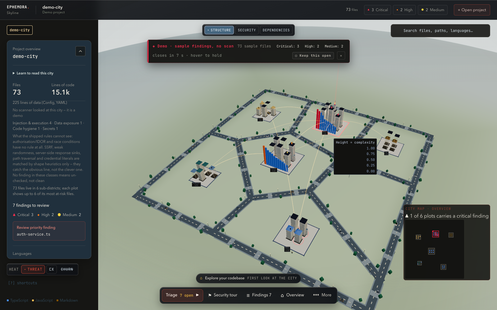
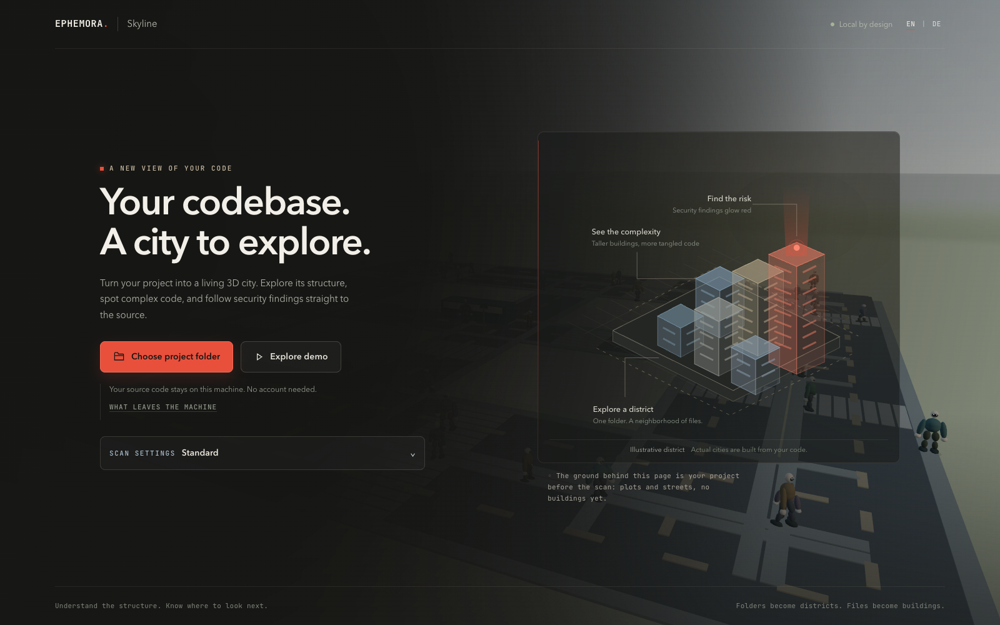
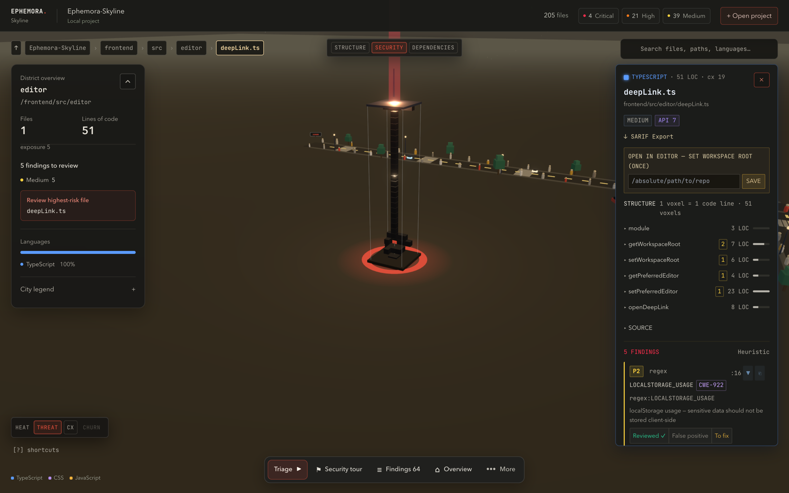
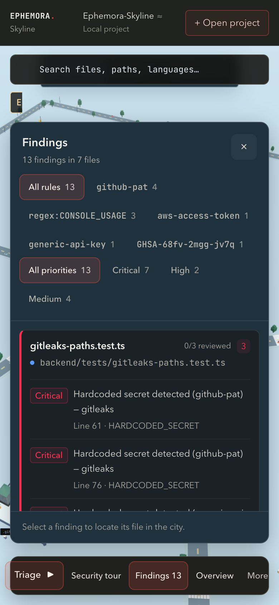

# Ephemora Skyline

**Your local codebase, rendered as a living 3D city in daylight.** Point it at a folder and watch it rise: folders become districts, files become buildings, a taller building holds more tangled code, and a red beacon marks a security finding. Your source never leaves the machine.



<p align="left">
  =20" src="https://img.shields.io/badge/node-%3E%3D20-339933?style=flat&logo=nodedotjs&logocolor=white">
  
  
  
  
</p>

> No CI badge yet, on purpose: `main` has been green since run [37195376374](https://github.com/MichaelS1011/Ephemora-Skyline/actions/runs/37195376374), but this repository is still private, and a badge served by GitHub only renders for someone who can already read the repo. The badge goes in the day it goes public. The gates below are exactly what CI enforces — run them locally first.

## Why it is different

Most security tooling is a list of findings you scroll. Ephemora Skyline makes a codebase **spatially legible**, so "where is the risk?" is answered by sight before you read a line. Clarity is the first security control — and a number you cannot check is not a measurement, so every channel in the city is a real metric.

| What you see                  | What it encodes                              |
| ----------------------------- | -------------------------------------------- |
| Building height               | Cyclomatic complexity of that file           |
| Red beacon, landmark tower    | Security findings, weighted by risk          |
| Plot and district             | Folder, with its most at-risk files drawn    |
| Yellow lasers                 | Copy-paste clones between files              |
| Red rings                     | Circular imports                             |
| Blue shield                   | Test coverage, when an `lcov` report exists  |
| Grey-brown "unscanned" colour | No engine looked here — not a claim of clean |

- **It builds in front of you.** Every visit starts on an empty lot. Pick a folder and the city assembles — roads, plots, buildings — while the Ephe's, the citizens who do the construction, explain what they are raising.
- **Scale-independent semantic zoom.** The overview shows one block per top-level folder whether the repo has 100 files or 50,000. Click into a block to open it as its own district. Files that are not drawn show honestly as a podium ("+N more files"), never silently dropped.
- **Security Tour.** The camera flies finding to finding, highest risk first, with a plain-language explanation and a fix suggestion.
- **Findings you can verify.** Every finding carries its file, its line, a two-line code frame and a link to the rule that fired. Open the file in your editor from the card. Each one also carries a fingerprint — rule, path, line and the (masked) line itself — so a verdict you record survives scanning the same folder again, and the same finding can be named in a report, in the city JSON and by an agent. A finding that moves to another line or into a renamed file counts as a new one, and says so.
- **Orientation, always.** Breadcrumbs, a minimap showing the real camera position, search-to-fly, keyboard navigation.
- **Shareable.** PNG export of the current view, SARIF 2.1.0 export of the findings (with the scan's id and each finding's fingerprint as `partialFingerprints`), and a `?city=<id>` link for the person already running the same backend.

## Quick start

Requires **Node >= 20** and **npm >= 10**. Optional: `gitleaks`, `semgrep`, `osv-scanner` and `ruff` on `PATH` — without them the corresponding checks report themselves as skipped instead of pretending to have run.

```bash
git clone https://github.com/MichaelS1011/Ephemora-Skyline.git
cd Ephemora-Skyline
npm install            # workspaces: frontend + backend
npm run dev            # backend on :4000 + frontend on :3010
```

Open **http://localhost:3010** and click **Choose project folder** — or **Explore demo** first, for the full experience with no folder of your own.

### The gates CI enforces

```bash
npm run lint           # ESLint, zero warnings
npm run type-check     # tsc --noEmit, both packages
npm run test           # Vitest — 735 tests in 86 files (391 frontend, 344 backend)
npm run build          # production build, both packages
node scripts/audit-gate.mjs   # dependency audit, see below
```

The audit gate fails on every high or critical finding **except** those explicitly accepted in `scripts/audit-gate.mjs` with a reason and a re-check date. Today one advisory is accepted: `braces` (GHSA-vfj7-8cjw-p6xm) has no fixed release, and it reaches the tree only through the file watcher that Tailwind's build depends on. It is named in the gate rather than hidden by a lowered threshold.

## Privacy model

The backend binds to `127.0.0.1` by default, and the two routes that execute anything additionally refuse requests that a foreign web page sent (checked by `Origin` / `Sec-Fetch-Site`, so a random site you visit cannot make your local scanner run your tests). The table below is not decoration: the entry screen of the app renders the same list from the same declaration the backend obeys (`OUTBOUND_CALLS`), and a test fails if the two ever name different hosts. What that test pins is the host set — the wording of each row is written twice, so it can drift while the hosts still match. The browser asks nothing of the network before you do anything: the UI font ships inside the app, and a separate test fails if the entry document ever references a third-party host.

When you pick a folder, the **browser** reads it and posts the contents to the local backend over `127.0.0.1`: your source is never uploaded and never sent to a third party — it crosses the loopback interface and stops there. What does leave the machine are lookups the scanners make for themselves, and those carry names, never code:

| Host                   | Made by                             | Leaves the machine                                          | When                                                  |
| ---------------------- | ----------------------------------- | ----------------------------------------------------------- | ----------------------------------------------------- |
| `api.github.com`       | the app (update check)              | one anonymous request for the newest release tag            | once an hour, if the update check is on               |
| `semgrep.dev`          | `semgrep`                           | the name of the rule pack it downloads (`p/security-audit`) | a Semgrep scan with no local rule pack selected       |
| `api.osv.dev`          | `osv-scanner`                       | package names and versions read out of your lockfiles       | a scan with the OSV check switched on                 |
| `api.deps.dev`         | `osv-scanner`                       | the same package names, resolved against the deps.dev index | with `osv-scanner` installed, next to the OSV queries |
| `registry.npmjs.org`   | `npm audit`                         | the same dependency names, via npm's advisory path          | dependency check on, but no `osv-scanner` installed   |
| `pypi.org`             | `pip-audit`                         | Python requirement names and versions                       | OSV check on, but no `osv-scanner` installed          |
| `registry-1.docker.io` | the Semgrep Docker fallback         | nothing but an image pull (`semgrep/semgrep:1.162.0`)       | Semgrep selected, no binary on `PATH`, Docker present |
| `registry.npmjs.org`   | `npm ci` in the in-city test runner | whatever your own project's tests install                   | only when you press **Run test file** on a building   |

`SKYLINE_OFFLINE=1` switches off the update check, the OSV check and the dependency check, and switches off Semgrep unless a local rule pack is selected — a pack that is already on your disk needs no download. It also closes the three paths a profile never asks about: **pip-audit** is skipped instead of resolving requirements against `pypi.org`, the **Semgrep Docker fallback** only runs on an image already cached locally instead of pulling one, and **Run test file** refuses to `npm ci` a staged copy that has no `node_modules`. With the switch set, nothing in the table above is reached. It is an environment variable, not a UI control yet. The city then reports what went missing through `scanProvenance` and paints those buildings the colour of ground no scanner looked at, instead of calling them clean.

**What the staged copy is.** To scan a folder the backend writes it to `$TMPDIR/codecity-uploads/<id>` with owner-only permissions, and keeps it for 24 hours (override with `CODECITY_UPLOAD_DIR` / `CODECITY_UPLOAD_TTL_HOURS`) so the in-city test runner can execute your project's own tests from the city you are looking at. The folder picker sends `.git` too — up to 20 MB of it, in its own budget — because churn, author districts and the deep profile's history scan are impossible without commit history. Local analysis is capped at **3000 files / 40 MB / 2 MB per file** and skips `node_modules`, build output and other directories that never hold relevant source.

**What the saved city carries.** A finding stores the line it was found on plus a two-line code frame, and the result is served as JSON you can export and share. The value of any credential-shaped assignment (`NAME = "…"`, `"NAME": "…"`) is erased to `‹hidden›` before the finding is kept — the name stays, because the name is what tells you where to fix. Masking is not limited to secret findings: it runs on every frame at the scanner boundary, because a `console.log` one line above a password carries that password in its neighbour lines. `.env`, `.env.production` and friends are in the scan surface **because** of that masking, and are read as data — no complexity, no code-shape questions.

**Telemetry: none.** No analytics, no beacon of its own — the only request the app makes for itself is the anonymous release check in the table above. Maintainers measure adoption through [GitHub's traffic and clone statistics](https://docs.github.com/en/rest/metrics/traffic) (`GH_TOKEN=*** node scripts/clone-stats.mjs`), which count clones without identifying anyone.

**How long a city lives.** Results are held in the backend's memory: the last 20 cities, for 24 hours. A `?city=<id>` link therefore works while that backend process is running — it is a pointer into a live session, not an archive. Export the PNG or the SARIF if you need the finding to outlive the process.

## What it checks

Pick a profile, or configure your own:

| Profile      | What it does                                                                                                |
| ------------ | ----------------------------------------------------------------------------------------------------------- |
| **Quick**    | Heuristics, secrets and dependency advisories, critical findings only — no AST scan, no OSV, no Python lint |
| **Standard** | Every check: regex heuristics, `gitleaks`, `semgrep`, dependency audit, OSV, `ruff`                         |
| **Deep**     | Standard plus a secret scan of the git history                                                              |
| **Security** | Security findings without the style noise                                                                   |
| **Quality**  | Dead code, clones and hygiene only — no security engines                                                    |
| **Custom**   | The same checks, chosen by you: categories, engines and rule pack                                           |

Findings are grouped into nine categories you can switch per scan — injection and execution, secrets, cryptography, transport and certificates, data exposure, dependencies and supply chain, permissions and destructive actions, code hygiene, and a bucket for findings whose rule carries no CWE the taxonomy knows.

Your own patterns are supported too: up to 25 regular expressions with severity, message, suggested fix, CWE and language gates. Each one is validated against a ReDoS canary before it is ever run.

### Rule packs

The deep AST scan needs rules, and where those rules come from is a decision with a licence attached. The Semgrep Rules License v1.0 states: "This license does not allow you to distribute the rules, or to make them available to others as a service." So the registry stays what it always was — fetched by `semgrep` itself, by you, at scan time — and what ships in this repository is rules we wrote and own.

| Pack                 | Where it lives                                                       | Rules | Licence                                              |
| -------------------- | -------------------------------------------------------------------- | ----- | ---------------------------------------------------- |
| `ephemora-core`      | `backend/rules/ephemora-core/`                                       | 12    | BSL-1.1, same as the program — ours to ship and grow |
| _(nothing selected)_ | `semgrep.dev`, during the scan                                       | 225   | Semgrep Rules License v1.0 — not redistributable     |
| your own             | `~/.ephemora-skyline/rule-packs/<id>/` (or `CODECITY_RULE_PACK_DIR`) | any   | yours                                                |

A pack is a directory with a `pack.json` manifest and rule YAML beside it. The manifest's `ruleCount` is checked against the files at load time, and a pack whose manifest lies is not offered at all. Scans select packs **by id**; a path is rejected, because a client-supplied directory would let the scanner read rules from anywhere on the machine.

## The look

| Entry                                                                                                          | One district, security mode                                      |
| -------------------------------------------------------------------------------------------------------------- | ---------------------------------------------------------------- |
|  |       |
| What the tool is, in one screen, before it has anything of yours.                                              | One directory in: the towers that hold findings carry the beams. |

| A building and its file card                                                         | On a phone                                                  |
| ------------------------------------------------------------------------------------ | ----------------------------------------------------------- |
|                      |       |
| Size, complexity, every section, and each finding with the line and rule that fired. | Panels stay inside the viewport; the city stays explorable. |

The interface speaks English and German; the switch is in the header and the choice is remembered.

## Architecture

Full detail in [`docs/ARCHITECTURE.md`](./docs/ARCHITECTURE.md), first run in [`docs/GETTING_STARTED.md`](./docs/GETTING_STARTED.md), UI review notes in [`docs/UI_REVIEW.md`](./docs/UI_REVIEW.md).

```
Ephemora-Skyline/
├── backend/src/
│   ├── server/            # Express app, loopback bind, local-only guard
│   │   └── routes/        # analyze-local, status, job-progress, result/source,
│   │                      # sarif, demo, health, tests, update-check
│   ├── services/
│   │   ├── analyzer/      # pipeline: enumerate -> parse -> metrics -> aggregate
│   │   └── security/      # scanner facade + adapters (regex, gitleaks, semgrep,
│   │                      # dependency, osv, ruff) + categories, dedup, redact,
│   │                      # rule-packs, scan-config, network-policy
│   ├── models/            # CityData, Finding, FileNode
│   └── utils/             # cityMapper (layout) + SARIF export
├── frontend/src/
│   ├── city/              # layout, palette, types, geometry
│   ├── components/        # 3D scene + HUD (CityScene, Building, InfoPanel,
│   │                      # FindingsPanel, Minimap, SearchBar, Triage, ...)
│   ├── config/            # scan profiles, finding categories, rule packs
│   ├── editor/            # deep links into your editor, workspace root
│   ├── findings/          # finding presentation and knowledge
│   ├── hooks/             # useLocalAnalysis, useTestRunner, ...
│   ├── stores/            # Zustand
│   ├── design/            # design tokens and CSS
│   ├── i18n.ts            # the interface strings, EN and DE
│   ├── prefs.ts           # language, graphics-lite, colour-blind mode
│   └── reviews.ts         # triage state, per city
├── docs/                  # ARCHITECTURE, GETTING_STARTED, UI_REVIEW, assets/
├── scripts/               # audit-gate, clone-stats
└── .github/               # CI, issue and PR templates, dependabot
```

## API (`:4000`)

| Method and path                       | Purpose                                                            |
| ------------------------------------- | ------------------------------------------------------------------ |
| `GET  /api/health`                    | liveness                                                           |
| `GET  /api/demo`                      | the seeded demo city (`demo-001`)                                  |
| `GET  /api/cities/default`            | the default city for a cold start                                  |
| `POST /api/analyze-local`             | analyze a folder picked in the browser (primary path)              |
| `GET  /api/status/:id`                | progress of a running analysis (polled)                            |
| `GET  /api/result/:id`                | full analysis result as JSON                                       |
| `GET  /api/result/:id/city`           | the city payload the renderer consumes                             |
| `GET  /api/result/:id/sarif`          | SARIF 2.1.0 export of the findings                                 |
| `GET  /api/result/:id/source/:fileId` | the file a finding points at                                       |
| `GET  /api/rule-packs`                | the rule packs on this disk, and whether the offline switch is set |
| `POST /api/tests/:id/run`             | run one of that city's own test files                              |
| `GET  /api/tests/run/:runId`          | output of that run                                                 |
| `GET  /api/update/check`              | the anonymous newest-release check                                 |

## Contributing

The gates, commit conventions and PR checklist are in **[CONTRIBUTING.md](./CONTRIBUTING.md)**. Small, reviewable changes land fastest. Interface strings need both an English and a German entry. Anything that changes the 3D render needs a real-GPU screenshot — headless CI cannot judge a WebGL scene. The "Ephemora Skyline" name and the BSL-1.1 licence are not negotiable.

## License

**Business Source License 1.1 (BSL-1.1)** — see [LICENSE](./LICENSE). Source-available, **not** OSI open-source.

- **Allowed:** read, modify, run and share the code for personal, educational, internal-business and all non-production purposes (development, testing, evaluation, research).
- **Not allowed** without a separate commercial licence: offering the software or derivatives to third parties as a hosted or managed service (SaaS).
- **Automatic conversion:** on the Change Date (**2030-09-29**) the licence converts to **Apache License 2.0**.
- **Bundled under their own terms:** the UI typeface is JetBrains Mono, **SIL Open Font License 1.1**, taken from `@fontsource` and served by the app itself rather than a font CDN. Its licence text ships with the build (`OFL-JetBrains-Mono.txt`), and a test fails if a bundled font ever travels without one.

Copies must retain this licence, the "Ephemora Skyline" branding and all copyright notices. Commercial licences (hosted-service rights, white-labelling, enterprise redistribution) are available from Ephemora.
