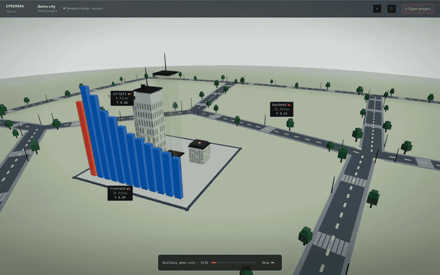

# Ephemora Skyline

<p align="left">
  <a href="https://github.com/MichaelS1011/Ephemora-Skyline/blob/main/LICENSE"></a>
  
  
  
  
  
  
  
</p>

<a href="docs/assets/demo-city.mp4"></a>

<sub>**[Watch the 27-second clip](docs/assets/demo-city.mp4)** — one visit, filmed as it happens: the entry screen, the demo opened, the city building itself, the tour flying finding to finding. No sound, no cuts, no sped-up frames, every pixel drawn by the app on a laptop.</sub>

**Skyline turns a folder of code into a 3D city you can look around in.** A folder is a district. A file is a building. A taller building means more tangled code inside it, and a red light on top means a security finding. Click a building and you get the file, the line, the rule that fired and the steps to fix it.

Nothing is uploaded. No account, no login, no telemetry. It runs on your own machine and opens in your browser — **your source is never uploaded and never sent to a third party**. English and German. Desktop web app; phones are not supported and not planned.

## What's new

0.4.0 — 2026-10-27

- **The arrival plate holds the width its own stylesheet promised** — plate 878,641 → 620 px, overflow 258,641 → 0 px
- **The house rules fire before anything is downloaded** — a folder scanned with no `semgrep` and no `gitleaks` on `PATH` yields 7 findings
- **A stranger sees the city first** — hero 203×127 → 838×524 px at 1280 wide, caption 12 px
- **A newer version is announced, not waited for** — one anonymous request an hour, and the check is on from the first run

More in [CHANGELOG.md](./CHANGELOG.md).

## Run it

Needs **Node 20.19+ or 22.12+** (Node 21 is unsupported) and **npm >= 10**. Four commands.

```bash
git clone https://github.com/MichaelS1011/Ephemora-Skyline.git   # Apache-2.0: a mirror or a fork is fine
cd Ephemora-Skyline
npm install
npm start              # builds once, then app + API on :4173, and opens the browser
```

Open **http://127.0.0.1:4173** and press **Choose project folder**. Or press **Explore demo** first — that city is sample files with sample findings, and no scanner ran on it. `npm run dev` is the coding loop (Vite on :3010, API on :4000). Every screen, switch and shortcut is walked through in [`docs/GETTING_STARTED.md`](./docs/GETTING_STARTED.md).

Optional: `gitleaks`, `semgrep`, `osv-scanner` and `ruff` on your `PATH`. Without them the city says which checks did not run, instead of pretending.

## What the city means

| What you see               | What it encodes                                                                   |
| -------------------------- | --------------------------------------------------------------------------------- |
| Building height            | Synthetic complexity: 45% cyclomatic, 30% import-count depth proxy, 25% file size |
| Red beacon, landmark tower | Security findings, weighted by risk                                               |
| Plot and district          | Folder, with its most at-risk files drawn                                         |
| Yellow lasers              | Copy-paste clones between files                                                   |
| Red rings                  | Circular imports                                                                  |
| Blue shield                | Test coverage, when an `lcov` report exists                                       |
| Grey `#6b6a63` "unscanned" | No engine looked here — not a claim of clean                                      |

## What you can do

- **Walk it.** One block per top-level folder from above, ten folders or ten thousand. Click a block to open it as its own district.
- **Read the names from far away.** A district label keeps a fixed legible size however far the camera is, and never paints over its neighbour. A folder name too long for its plate is cut there and read in full by a screen reader.
- **See which files are too big.** A file past 500 lines, 50 branches, or carrying one line past 300 characters gets a note on its own card with the measured number and what splitting buys. Those notes are deliberately **not** findings — run through the scanner, this repository's self-scan answered 38 findings, then 122, the lecture burying the queue the city exists for.
- **Take the Security Tour.** The camera flies finding to finding, worst first, and explains each one in plain words with a fix suggestion.
- **Ask a resident.** Press `C` and a resident you call walks you to the highest finding that still needs your verdict.
- **Get pointed back.** When a finding you still have to judge sits off-screen, a small pill shows at the screen edge with a word — `left`, `right`, `behind` — and the distance. Press it, the camera flies there.
- **Judge, not just read.** Every finding carries its file, its line, the matched line with two lines either side from your own copy, the rule behind it and a fingerprint. Your verdict survives the next scan, and a coding agent can be pointed at the same finding.
- **Hold `X` over a tower** and it shows the raw numbers behind its shape. Press `/` or Cmd/Ctrl+K to search. One control hides every panel and gives the city the whole window; `Esc` brings them back.
- **Share it if you want.** The built-in studio renders MP4/H.264 1080p video and PNG locally. You get the file — no suggested caption, no platform row. SARIF 2.1.0 carries the scan id and the fingerprints.
- **Ask whether a newer version exists.** One row in the ••• menu queries the published releases once and answers in words, in all four cases: a newer version with a link, "you are on the newest published version", "nothing published to compare with yet" — which is the honest answer while no release is tagged — or "could not check" when your machine says no. The hourly background check stays off until you turn it on.
- **Come back to it.** Reload, and the district, the selection and the camera are where you left them.

## What it will not tell you

Read this before the list above means anything.

- **A finding is a rule that matched, not an exploit proven.** Every card names the scanner and the line, so you can check it. The check is the product; the red light is only the pointer.
- **There is no accuracy number here, on purpose.** Precision and recall need an annotated corpus this repository does not have, so the honest scan to show is its own: the default profile over this checkout reported 38 findings, and 1 of them landed on an `expect(...)` line — a `gitleaks` `aws-access-token` hit on a test's own masking assertion, not a credential in shipped code. Three further `P0`s sit in `scripts/`: two `EVAL_USAGE` hits on Puppeteer element-evaluation calls and a `stripe-access-token` on a synthetic key template. In `backend/src` and `frontend/src`: none. The list ships as [`docs/self-scan-findings.ndjson`](./docs/self-scan-findings.ndjson), and where all 38 sit is in [`docs/LIMITS.md`](./docs/LIMITS.md).
- **It does not run your code.** No execution, no fuzzing, no reachability proof. The one route that executes something is named on screen: **Run test file** runs your own project's test file, only after you press it.
- **It does not write to your project.** The explanation layer has a voice and no pen.
- **A city is not an archive.** Results live in the local process — the last 20, for 24 hours. Export SARIF or PNG if a finding has to outlive it.
- **Nothing leaves the count without a number.** Files that never joined a scan are drawn grey and counted by the reason they left — too long a path, refused as unsafe, too large, unreadable, excluded by you, set aside by your own `.gitignore`, past the history budget, or a shape the scanners do not read. The summary line adds them up, so “32 files” and “30 files were not read” arrive together, and the way around the file cap is a field on the entry screen, not a config file: _Excluded folders_ stores them, reads them back and caps the list at fifty.

## It says so when it cannot read

Every stored setting answers one of three things: read, absent, **unreadable**. Bytes that refuse to parse are parked under their own key and survive the next save, and the screen says the difference in words instead of showing an empty state. This covers the verdict file on disk (while it reads badly no write and no reset touches it), the rule packs, the excluded folders, the list of cities you opened, your preferences, the names you gave residents, the saved look of the figure, this browser's verdicts, the record of earlier scans, the chosen scan profile and the entry screen's count of saved names — fourteen sentences, English and German.

Colour never carries a meaning alone: severity chips have a shape and a word, an alarm plot gets a wedge _and_ a count, and the colour-blind palette reaches every surface that paints a severity. Gold means one thing only: where your keyboard is. Guarded in `frontend/tests/arrival-budget.test.tsx` (four standing surfaces) and `frontend/tests/waypoint.test.tsx`.

## Privacy

The backend binds to `127.0.0.1` by default, and the fifteen routes that carry the origin guard refuse a request a foreign web page sent, checked by `Origin` and `Sec-Fetch-Site`. Ten of them can do something beyond answering a question: start a scan, fold a live delta into one, cancel one, run a folder's own tests, purge staged copies, verify a scan against a later one, write a project's verdicts, delete every stored verdict, export a city, ask a model on this machine about one flagged line. The five reads of the local program: the demo, the city-mapped demo, the rule-pack list, the rule-class names, the disk footprint. When you pick a folder, the browser reads it and posts the contents over loopback — code crosses the loopback interface and stops there. What does leave the machine are lookups the scanners make for their own rule and advisory data, and those carry names, never code:

| Host                   | Made by                             | Leaves the machine                                          | When                                                                                                |
| ---------------------- | ----------------------------------- | ----------------------------------------------------------- | --------------------------------------------------------------------------------------------------- |
| `api.github.com`       | the app (update check)              | one anonymous request for the newest release tag            | once an hour, on from the first run — one click in a city's More menu turns it off and it stays off |
| `semgrep.dev`          | `semgrep`                           | the name of the rule pack it downloads (`p/security-audit`) | a Semgrep scan with no local rule pack selected                                                     |
| `api.osv.dev`          | `osv-scanner`                       | package names and versions read out of your lockfiles       | a scan with the OSV check switched on                                                               |
| `api.deps.dev`         | `osv-scanner`                       | the same package names, resolved against the deps.dev index | with `osv-scanner` installed, next to the OSV queries                                               |
| `registry.npmjs.org`   | `npm audit`                         | the same dependency names, via npm's advisory path          | dependency check on, but no `osv-scanner` installed                                                 |
| `pypi.org`             | `pip-audit`                         | Python requirement names and versions                       | OSV check on, but no `osv-scanner` installed                                                        |
| `registry-1.docker.io` | the Semgrep Docker fallback         | nothing but an image pull (`semgrep/semgrep:1.162.0`)       | Semgrep selected, no binary on `PATH`, Docker present                                               |
| `registry.npmjs.org`   | `npm ci` in the in-city test runner | whatever your own project's tests install                   | only when you press **Run test file** on a building                                                 |

The entry screen renders this same list from the same declaration the backend obeys, and a test fails if the two ever name different hosts. `SKYLINE_OFFLINE=1` switches off the update check, the OSV and dependency checks, and Semgrep unless a local rule pack is on disk; it also closes pip-audit, the Docker pull and any `npm ci` the runner would attempt. With it set, nothing above is reached.

Limits are numbers too: local analysis is capped at **10,000 files / 150 MB / 2 MB per file**, a larger folder opens as a preview sample of up to 2,000 files with the full count named, and your own `.gitignore` sets paths aside before the cap applies. Over this checkout, the browser reader's own decision counts **630** files the project calls source and admits them to the read, and the scan's own single decision, `isScanCandidate`, then reads **607** of those. Two sets, two names, and `backend/tests/claims-counts.test.ts` calls both shipped functions over this tree and fails, printing both numbers, the moment this sentence drifts.

**Telemetry: none.** The only request the app makes for itself is the anonymous release check above — no code, no path, no machine identity, once an hour, and one click in a city's More menu ends it permanently. Maintainers read adoption through [GitHub's traffic and clone statistics](https://docs.github.com/en/rest/metrics/traffic) (`GH_TOKEN=*** node scripts/clone-stats.mjs`), which count clones without identifying anyone; those endpoints need a token with write access to this repository and report 14 days. The UI typeface ships inside the app, and a test fails if the entry document ever references a third-party host. More in [`docs/PRIVACY.md`](./docs/PRIVACY.md); reporting a vulnerability follows [SECURITY.md](./SECURITY.md).

## What it checks

| Profile      | What it does                                                                                                |
| ------------ | ----------------------------------------------------------------------------------------------------------- |
| **Quick**    | Heuristics, secrets and dependency advisories, critical findings only — no AST scan, no OSV, no Python lint |
| **Standard** | Every check: regex heuristics, `gitleaks`, `semgrep`, dependency audit, OSV, `ruff`                         |
| **Deep**     | Standard plus a secret scan of the git history                                                              |
| **Custom**   | The same checks, chosen by you: categories, engines and rule pack                                           |

Findings fall into nine switchable categories — injection and execution, secrets, cryptography, transport and certificates, data exposure, dependencies and supply chain, permissions and destructive actions, code hygiene, and a bucket for rules whose CWE the taxonomy does not know. Your own patterns work too: up to 25 regular expressions, each validated against a ReDoS canary before it runs. Where the Semgrep rules come from: [`docs/SCANNERS.md`](./docs/SCANNERS.md).

## Screens

Shot from this repository's build on 2026-10-21, on the sample city the app ships with — the one place a picture can be honest, because nobody's code is in it.

| Entry screen                                                                                                                                                        | Scan settings                                                                                                                                                            |
| ------------------------------------------------------------------------------------------------------------------------------------------------------------------- | ------------------------------------------------------------------------------------------------------------------------------------------------------------------------ |
|  |  |
| What the tool is, before it has anything of yours.                                                                                                                  | How deep to scan, and which folders to leave out.                                                                                                                        |

| Structure mode                                                                                                                                  | Security mode                                                                                                                                                                                                                                                                                                                                                                |
| ----------------------------------------------------------------------------------------------------------------------------------------------- | ---------------------------------------------------------------------------------------------------------------------------------------------------------------------------------------------------------------------------------------------------------------------------------------------------------------------------------------------------------------------------- |
|  |                                                                                                                                                                                    |
| 74 sample files in six districts, the riskiest file as a landmark tower.                                                                        | Two channels change here: towers with nothing critical or high dim, the active chip moves. Measured between the two frames with no tolerance and no region mask: 2.49 % of the pixels differ, and on those the median colour sum falls from 403 to 268. Everything else is byte-identical except one car, fourteen pixels further along. Channel split: `docs/UI_REVIEW.md`. |

| Findings list                                                                                                             | One finding, opened                                                                                                                                 |
| ------------------------------------------------------------------------------------------------------------------------- | --------------------------------------------------------------------------------------------------------------------------------------------------- |
|  |  |
| Eight findings in seven files, filterable by priority and by the rule that fired.                                         | `auth-service.ts`, line 23, `HARDCODED_SECRET`, CWE-798, the matched line, four steps.                                                              |

| Share result                                                                                                                                                            | More menu                                                                                                                                           | In German                                                                                                                                                  | Narrow window                                                               |
| ----------------------------------------------------------------------------------------------------------------------------------------------------------------------- | --------------------------------------------------------------------------------------------------------------------------------------------------- | ---------------------------------------------------------------------------------------------------------------------------------------------------------- | --------------------------------------------------------------------------- |
|  |  |  |  |
| The video alone, with the mark `by Ephemora Skyline` burned in.                                                                                                         | Export, view switches, and the surfaces you open when you want them.                                                                                | Interface, categories and fix recipes are bilingual; the scanner's own message stays as written.                                                           | Panels stay inside the viewport.                                            |

The clip at the top is the same visit, filmed end to end. The clip plays 27.2 s at 1600 × 1000 and 30 fps, 2,595 KB, one video stream and no audio track. The moving picture beside it is 7 seconds of that build, 70 frames at 640 × 400 and 10 fps, 3,227 KB.

## Documentation

First look in one screen — what you see, what you can do, what you cannot: [`docs/AT_A_GLANCE.md`](./docs/AT_A_GLANCE.md) · Every screen, switch and shortcut: [`docs/GETTING_STARTED.md`](./docs/GETTING_STARTED.md) · module map, render pipeline, live delta and budgets: [`docs/ARCHITECTURE.md`](./docs/ARCHITECTURE.md) · endpoints and what each one guards: [`docs/API.md`](./docs/API.md) · masking, staging, fingerprints, retention: [`docs/PRIVACY.md`](./docs/PRIVACY.md) · what the shipped rules cannot see, and the full self-scan: [`docs/LIMITS.md`](./docs/LIMITS.md) · rule packs and their licence: [`docs/SCANNERS.md`](./docs/SCANNERS.md) · feeding one finding to a coding agent: [`docs/AGENTS.md`](./docs/AGENTS.md) · how each frame above was measured: [`docs/UI_REVIEW.md`](./docs/UI_REVIEW.md)

## Contributing

**Apache License 2.0** — full text in [LICENSE](./LICENSE), attribution and the bundled components' licences in [NOTICE](./NOTICE). You may read it, run it, change it, ship it and sell work built on it; the name `Ephemora Skyline` is not part of what it grants (§6), and there is no warranty (§7, §8). How contributors treat each other in issues and pull requests is written in [CODE_OF_CONDUCT.md](./CODE_OF_CONDUCT.md).

`.github/workflows/ci.yml` runs five gates on every push to `main` and on every pull request: lint, the type check, the test suite, the build, the dependency audit. No status badge sits above this text — a badge would need a service to answer to — so the commands are here for you to run:

```bash
npm run lint                  # ESLint, zero warnings
npm run type-check            # tsc --noEmit, both packages
npm run test                  # Vitest — 306 test files: 218 frontend, 88 backend (2026-10-29)
npm run build                 # production build, both packages
node scripts/audit-gate.mjs   # dependency audit
```

3,433 cases measured 2026-10-27 — 2,522 frontend, 911 backend. The audit gate fails on every high or critical finding **except** those accepted in `scripts/audit-gate.mjs` by name with a dated re-check; on this lockfile `npm audit` reported `0 vulnerabilities` on 2026-10-26, so it passes on the fix and prints that the one remaining exception matches no finding. Gates, conventions and the PR checklist: **[CONTRIBUTING.md](./CONTRIBUTING.md)**. Small, reviewable changes land fastest. Interface strings need an English and a German entry, and anything that changes the 3D render needs a real-GPU screenshot — headless CI cannot judge a WebGL scene.

Skyline is the piece of this work meant to be read and argued with, not the piece meant to earn. What changed since the last line of the story, each entry measured before it was written, is in [CHANGELOG.md](./CHANGELOG.md).
